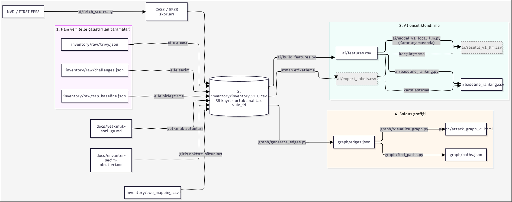

# ResidualMap

AI destekli, saldırı grafiği tabanlı bir güvenlik mimarisi prototipi.
Bilinen zafiyetleri saldırı yollarına dönüştürür, yapay zeka ile önceliklendirir,
katmanlı bir savunma tasarlar ve savunma öncesi/sonrası artık riski ölçer.

## Proje Özeti

- **Hedef uygulama:** [OWASP Juice Shop](https://github.com/juice-shop/juice-shop)
- **Ders:** Engineering Design II
- **Süre:** 10 hafta

## Ekip

| Kişi | Rol | GitHub |
|---|---|---|
| [Ekrem Arda Kınık] | Proje Yöneticisi / Entegrasyon | [@Tek258](https://github.com/Tek258) |
| [Arda Şahindokucuyu] | Zafiyet Envanteri | [@Leroy0734](https://github.com/Leroy0734) |
| [Göktürk Ulutaş] | Saldırı Grafiği | [@GokturkUlutas](https://github.com/GokturkUlutas) |
| [Fatih Yılmaz] | AI ile Önceliklendirme | [@FatihYilmaz449](https://github.com/FatihYilmaz449) |
| [Engin Armağan] | Savunma Mimarisi | [@EnginArmagan](https://github.com/EnginArmagan) |

## Yöntem

1. **Envanter** — Hedef uygulamadaki bilinen zafiyetleri tara, CVSS ile puanla
2. **Saldırı Grafiği** — Zafiyetleri MITRE ATT&CK / CAPEC ile ilişkilendirip saldırı yolları çıkar
3. **AI ile Önceliklendirme** — Saldırı yollarını ML/LLM tabanlı bir modelle risk sırasına koy
4. **Savunma Mimarisi** — WAF, IDS/IPS, SIEM, IAM ve ağ segmentasyonu ile katmanlı savunma kur
5. **Artık Risk Ölçümü** — Savunma öncesi ve sonrası riski karşılaştır

## Klasör Yapısı
    residualmap/
    ├── docs/ → notlar, özetler, mimari diyagramlar, toplantı notları
    ├── inventory/ → zafiyet envanteri ve ham tarama çıktıları
    ├── graph/ → saldırı grafiği kodu ve görselleştirmeleri
    ├── ai/ → risk skorlama modeli, veri ve sonuçlar
    ├── defense/ → WAF, IDS, SIEM, ağ segmentasyonu yapılandırmaları
    └── report/ → teknik rapor ve görseller

## Veri Akış Şekli

Düz oklar scriptlerle otomatik, kesikli oklar elle yapılan adımları gösterir. Tüm tablolar vuln_id ile birleşir.

## Tarama ve savunma kanıtı

- Trivy hedefi: `bkimminich/juice-shop:v20.2.0@sha256:8739101ade29358abb5469ee66ae78e582c97ed0a5543a4ad102e5fa5193526b`.
- Mevcut `inventory/raw/trivy.json` referans taramasının `Metadata.ImageID` ve `Metadata.RepoDigests` değerleri ek kanıtın kaydı olarak bulunmalıdır. İkinci tarama JSON'u eklenmeden aynı imajdaki 175→200 CVE artışının nedeni yalnızca DB güncellemesi olarak iddia edilmemelidir.
- Trivy sürümü ve DB güncelliği: tarama çalıştırılırken `trivy --version` çıktısındaki `Vulnerability DB ... UpdatedAt` satırı PR'a eklenmelidir.
- Referans tarama koşulu 08.10.2026: ZAP hedefi `http://host.docker.internal:8080`; port 8080'de hangi uygulama ve WAF modu bulunduğu ilgili tarama günlüğünde belirtilmelidir.
- DetectionOnly kanıtı: WAF `MODSEC_RULE_ENGINE=DetectionOnly` iken `defense/test-waf.sh` `defense/test-waf-detectiononly.log` olarak kaydedilmelidir.
- V019: ürün ve ters vekil yapılandırması [defense/docker-compose.yml](defense/docker-compose.yml) içinde `SERVER_TOKENS=off`, `SERVER_HEADER=""` ile belirlenir; [curl çıkışı](defense/v019-header.txt) eklenmeden sonuç kanıtlı kabul edilmez.
- V022–V036: `inventory/control_mapping.csv` sütunundaki yama değeri `uygulanmadi`dır. Yama uygulanmış bir paket/yol kanıtı olmadan bu kayıtlar kütüphane riskinde düşüş olarak sayılmaz.
- Yapılandırma kontrolü: [inventory/control_mapping.csv](inventory/control_mapping.csv) dosyasında kullanılan yapılandırma değerleri kontrol listesiyle aynı tutulmalıdır.

## Lisans

Bu proje eğitim amaçlıdır. Hedef uygulama olan OWASP Juice Shop MIT lisansı ile dağıtılmaktadır.

