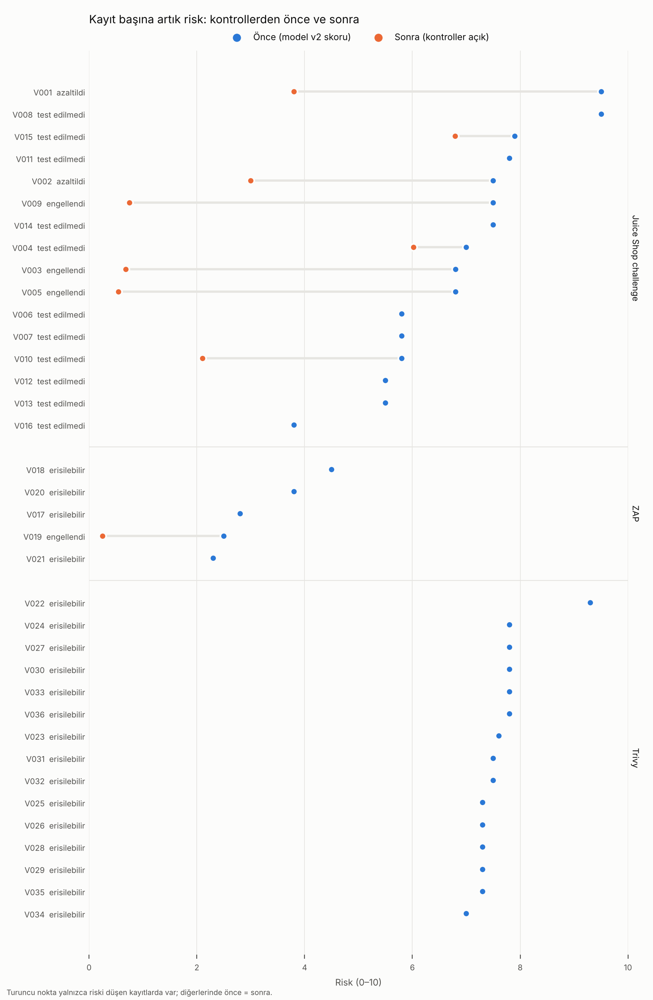

# Önce/sonra özeti (S6-K4)

Kontroller (WAF, sanal yama, IDS, IAM, segmentasyon) devreye girdikten sonra artık riskin ne kadar düştüğü. Sayılar `ai/before_after.csv`'den `python ai/before_after.py` ile üretilir; risk tanımı `docs/olcum-metodolojisi.md`'de.

- `risk_before`: model v2 skoru (`ai/results_v2_llm.csv`)
- `risk_after = risk_before × (1 − toplam etkinlik)` (`ai/residual_risk.csv`)
- `durum`: kontroller açıkken gözlenen sonuç (`inventory/after_controls.csv`)

## 1. Toplam düşüş

| Kapsam | Kayıt | Önce (Σ) | Sonra (Σ) | Düşüş | Düşüş % | Kayıt başına ort. |
|---|---|---|---|---|---|---|
| Bütün kayıtlar | 36 | 240.30 | 202.95 | 37.35 | %15.5 | 1.04 |
| **Yalnızca test kanıtlı** | 9 | 50.20 | 18.62 | 31.58 | %62.9 | 3.51 |

Güvenilir sayı ikinci satır: etkinliği test edilmiş eşlemelere dayanıyor. `varsayim` dayanaklı 12 kayıt hesaba katılmadı (etkinlik 0, `risk_after = risk_before`).

## 2. Kontroller açıkken durum

| Durum | Kayıt |
|---|---|
| engellendi | 4 |
| azaltildi | 2 |
| tespit_edildi | 0 |
| erisilebilir | 19 |
| test_edilmedi | 11 |

## 3. Kaynak türüne göre

| Kaynak | Kayıt | Önce (Σ) | Sonra (Σ) | Düşüş | Düşüş % | Kayıt başına ort. |
|---|---|---|---|---|---|---|
| Juice Shop challenge: uygulama zafiyeti (challenge ile doğrulanmış) | 16 | 110.00 | 74.90 | 35.10 | %31.9 | 2.19 |
| ZAP: web yapılandırma bulgusu (pasif tarama) | 5 | 15.90 | 13.65 | 2.25 | %14.2 | 0.45 |
| Trivy: kütüphane / işletim sistemi paketi | 15 | 114.40 | 114.40 | 0.00 | %0.0 | 0.00 |

Kütüphane zafiyetlerinde düşüş %0.0: ağ kontrolleri paketlerin içini görmez ve hiçbir yama uygulanmadı. Toplam düşüşün %94'i uygulama zafiyetlerinden, kalanı ZAP bulgularından (V019) geliyor.

## 4. En çok düşen 5 kayıt

| Kayıt | Ad | Önce | Sonra | Fark | Durum | Açıklama |
|---|---|---|---|---|---|---|
| V009 | Dizin listeleme - /ftp gizli dokuman (Confidential Document) | 7.50 | 0.75 | 6.75 | engellendi | iam:engeller: kontroller açıkken saldırı isteği engelleniyor. |
| V005 | API-only (Stored) XSS | 6.80 | 0.54 | 6.26 | engellendi | waf:engeller, ids:tespit_eder: kontroller açıkken saldırı isteği engelleniyor. |
| V003 | Reflected XSS - siparis takip | 6.80 | 0.68 | 6.12 | engellendi | sanal_yama:engeller: kontroller açıkken saldırı isteği engelleniyor. |
| V001 | SQL Injection - login formu (Login Admin) | 9.50 | 3.80 | 5.70 | azaltildi | waf:azaltir, ids:tespit_eder: saldırı isteği engelleniyor ama tam eşikte, güvenlik payı yok. |
| V002 | UNION SQL Injection - urun arama (Database Schema) | 7.50 | 3.00 | 4.50 | azaltildi | waf:azaltir, ids:tespit_eder: saldırı isteği engelleniyor ama tam eşikte, güvenlik payı yok. |

## 5. Hiç düşmeyen kayıtlar (27)

| Kayıt | Ad | Risk | Durum | Açıklama |
|---|---|---|---|---|
| V008 | Mass Assignment - admin kaydi (Admin Registration) | 9.50 | test_edilmedi | Mantıksal / iş kuralı açığı; geçerli biçimdeki isteği WAF, IDS ve IAM ayırt edemiyor. |
| V022 | jsonwebtoken 0.1.0 / 0.4.0 - CVE-2015-9235 | 9.30 | erisilebilir | Kütüphane zafiyeti; hiçbir yama uygulanmadı ve ağ kontrolleri paketin içini görmez. |
| V011 | Zayif guvenlik sorusu ile sifre sifirlama (Reset Jim's Password) | 7.80 | test_edilmedi | Mantıksal / iş kuralı açığı; geçerli biçimdeki isteği WAF, IDS ve IAM ayırt edemiyor. |
| V024 | lodash 2.4.2 - CVE-2021-23337 | 7.80 | erisilebilir | Kütüphane zafiyeti; hiçbir yama uygulanmadı ve ağ kontrolleri paketin içini görmez. |
| V027 | decompress 4.2.1 - CVE-2026-101894 | 7.80 | erisilebilir | Kütüphane zafiyeti; hiçbir yama uygulanmadı ve ağ kontrolleri paketin içini görmez. |
| V030 | express-jwt 0.1.3 - CVE-2020-15084 | 7.80 | erisilebilir | Kütüphane zafiyeti; hiçbir yama uygulanmadı ve ağ kontrolleri paketin içini görmez. |
| V033 | ws 7.4.6 - CVE-2024-37890 | 7.80 | erisilebilir | Kütüphane zafiyeti; hiçbir yama uygulanmadı ve ağ kontrolleri paketin içini görmez. |
| V036 | libc6 2.41-12+deb13u3 - CVE-2019-1010022 | 7.80 | erisilebilir | Kütüphane zafiyeti; hiçbir yama uygulanmadı ve ağ kontrolleri paketin içini görmez. |
| V023 | lodash 2.4.2 - CVE-2019-10744 | 7.60 | erisilebilir | Kütüphane zafiyeti; hiçbir yama uygulanmadı ve ağ kontrolleri paketin içini görmez. |
| V014 | Acikta kalan kimlik bilgileri (Exposed Credentials) | 7.50 | test_edilmedi | Kimlik bilgisi istemci tarafı koda gömülü; ağ kontrolleri dosyanın içeriğini değiştirmez. |
| V031 | moment 2.0.0 - CVE-2022-24785 | 7.50 | erisilebilir | Kütüphane zafiyeti; hiçbir yama uygulanmadı ve ağ kontrolleri paketin içini görmez. |
| V032 | moment 2.0.0 - CVE-2017-18214 | 7.50 | erisilebilir | Kütüphane zafiyeti; hiçbir yama uygulanmadı ve ağ kontrolleri paketin içini görmez. |
| V025 | crypto-js 3.3.0 - CVE-2023-46233 | 7.30 | erisilebilir | Kütüphane zafiyeti; hiçbir yama uygulanmadı ve ağ kontrolleri paketin içini görmez. |
| V026 | crypto-js 3.3.0 - CVE-2026-71851 | 7.30 | erisilebilir | Kütüphane zafiyeti; hiçbir yama uygulanmadı ve ağ kontrolleri paketin içini görmez. |
| V028 | proxy-addr 2.0.7 - CVE-2026-90711 | 7.30 | erisilebilir | Kütüphane zafiyeti; hiçbir yama uygulanmadı ve ağ kontrolleri paketin içini görmez. |
| V029 | tar 6.2.1 - CVE-2026-23950 | 7.30 | erisilebilir | Kütüphane zafiyeti; hiçbir yama uygulanmadı ve ağ kontrolleri paketin içini görmez. |
| V035 | libc6 2.41-12+deb13u3 - CVE-2026-5450 | 7.30 | erisilebilir | Kütüphane zafiyeti; hiçbir yama uygulanmadı ve ağ kontrolleri paketin içini görmez. |
| V034 | multer 1.4.5-lts.2 - CVE-2025-47944 | 7.00 | erisilebilir | Kütüphane zafiyeti; hiçbir yama uygulanmadı ve ağ kontrolleri paketin içini görmez. |
| V006 | IDOR - baska kullanicinin sepetini gorme (View Basket) | 5.80 | test_edilmedi | Mantıksal / iş kuralı açığı; geçerli biçimdeki isteği WAF, IDS ve IAM ayırt edemiyor. |
| V007 | IDOR - baska kullanicinin sepetini degistirme (Manipulate Basket) | 5.80 | test_edilmedi | Mantıksal / iş kuralı açığı; geçerli biçimdeki isteği WAF, IDS ve IAM ayırt edemiyor. |
| V012 | CSRF - profil islemi | 5.50 | test_edilmedi | Mantıksal / iş kuralı açığı; geçerli biçimdeki isteği WAF, IDS ve IAM ayırt edemiyor. |
| V013 | Acik yonlendirme - eski allowlist (Outdated Allowlist) | 5.50 | test_edilmedi | Mantıksal / iş kuralı açığı; geçerli biçimdeki isteği WAF, IDS ve IAM ayırt edemiyor. |
| V018 | Cross-Domain Misconfiguration (genis CORS) | 4.50 | erisilebilir | Eksik güvenlik başlığı ya da istemci tarafı bulgu; kontroller sonrası taramada hâlâ var. |
| V016 | Ayrintili hata mesaji (Error Handling) | 3.80 | test_edilmedi | Hata yanıtlarını WAF denetlemiyor; ayrıntılı hata mesajı sızmaya devam ediyor. |
| V020 | Tehlikeli JS fonksiyonlari | 3.80 | erisilebilir | Eksik güvenlik başlığı ya da istemci tarafı bulgu; kontroller sonrası taramada hâlâ var. |
| V017 | CSP basligi yok | 2.80 | erisilebilir | Eksik güvenlik başlığı ya da istemci tarafı bulgu; kontroller sonrası taramada hâlâ var. |
| V021 | COOP/COEP basliklari eksik | 2.30 | erisilebilir | Eksik güvenlik başlığı ya da istemci tarafı bulgu; kontroller sonrası taramada hâlâ var. |

## 6. Grafik

