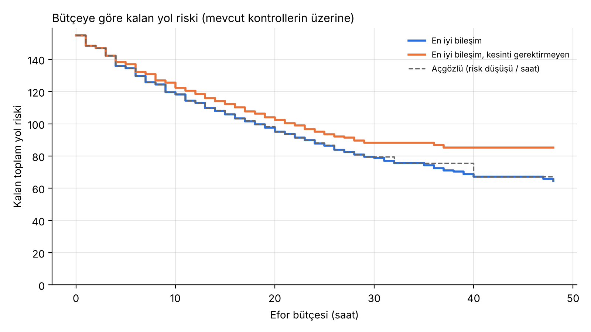

# Önlem seçimi ve uygulama öncesi senaryo

Soru: *sınırlı eforla kritik varlıklara giden yolların riskini en çok azaltan önlem bileşimi hangisi?* Aday önlemler henüz uygulanmadı; mevcut durumun (WAF, sanal yamalar, IDS, IAM, segmentasyon açık) üzerine eklenerek hesaplandı. Belge `python ai/onlem_secimi.py` ile üretilir.

- Aday önlemler: `inventory/onlem_katalogu.csv` (15 önlem, toplam 48 saat). Efor ve kesinti değerleri ekip tahminidir; gerekçesi katalogda.
- Önlem etkinliği metodoloji sözlüğünden: henüz uygulanmadığı için dayanak **gerekce** (`engeller` = 0.63). Uygulanıp test edilince 0.9 olur.
- Mevcut etkinlikle birleşim: `1 − (1 − e_mevcut)(1 − e_önlem)`. Yol riski: `Π P_i(1 − e_i) × C_hedef` (metodoloji 5.2, `paths_after.py` ile aynı).
- Amaç: toplam yol riskini en aza indirmek (kritik varlık ağırlıklı). Aday sayısı küçük olduğu için bütçeye sığan **bütün alt kümeler** denendi; sonuç kesin en iyidir. Açgözlü seçim karşılaştırma için.

## 1. Doğrulama

Uygulanmış kontroller (`control_mapping.csv`) aynı motorla sıfırdan eklendiğinde `ai/residual_risk.csv` 36 kayıtta birebir üretiliyor:

| | Kontrolsüz | Kontroller açık |
|---|---|---|
| Zafiyet riski (Σ) | 240.30 | 163.33 |
| Yol riski (Σ) | 243.53 | 154.85 |
| Kesilen yol | 0 | 13 |

Uygulanmış kontrollerin katkısı (o kontrol olmasaydı yol riski ne kadar yüksek olurdu):

| Kontrol | Yol riski katkısı | Zafiyet riski katkısı |
|---|---|---|
| Sanal yamalar | 35.39 | 31.73 |
| WAF ve nginx | 24.76 | 20.52 |
| IAM (Keycloak) | 6.30 | 6.75 |
| IDS (Suricata) | 1.80 | 2.11 |
| Segmentasyon | 0.10 | 0.12 |

## 2. Önlemler tek başına

Mevcut durum: yol riski 154.85, zafiyet riski 163.33, yollar 13 kesildi / 4 zayıfladı / 19 açık. Sıralama: saat başına yol riski düşüşü.

| Önlem | Hedef | Efor (sa) | Kesinti | Yol riski düşüşü | Saat başına | Test edilirse kapanan yol |
|---|---|---|---|---|---|---|
| K02 Ön yüzdeki gömülü kimlik bilgisini kaldırma | V014 | 1 | düşük | 6.30 | 6.30 | 1 |
| Y10 Taban imaj güncellemesi (libc6) | V035, V036 | 3 | var | 12.60 | 4.20 | 2 |
| Y07 moment yükseltmesi | V031, V032 | 3 | düşük | 10.08 | 3.36 | 2 |
| Y04 decompress yükseltmesi | V027 | 2 | düşük | 6.30 | 3.15 | 1 |
| K04 Arama sonucunu güvenli gösterme (bypassSecurityTrustHtml kaldırma) | V004, V020 | 2 | düşük | 5.26 | 2.63 | 2 |
| Y06 tar yükseltmesi | V029 | 2 | düşük | 4.60 | 2.30 | 1 |
| Y05 express ve proxy-addr yükseltmesi | V028 | 3 | düşük | 6.30 | 2.10 | 1 |
| Y02 lodash yükseltmesi | V023, V024 | 4 | düşük | 8.30 | 2.08 | 2 |
| Y09 multer yükseltmesi | V034 | 2 | düşük | 3.78 | 1.89 | 1 |
| K01 Sepet sahiplik kontrolü (IDOR) | V006, V007 | 4 | düşük | 7.35 | 1.84 | 2 |
| Y03 crypto-js yükseltmesi | V025, V026 | 2 | düşük | 3.13 | 1.57 | 1 |
| K05 Admin parolası değişimi ve parola politikası | V015 | 1 | yok | 1.44 | 1.44 | 1 |
| Y08 ws (socket.io) yükseltmesi | V033 | 3 | düşük | 3.78 | 1.26 | 1 |
| Y01 jsonwebtoken ve express-jwt yükseltmesi | V022, V030 | 8 | var | 8.40 | 1.05 | 2 |
| K03 Güvenlik sorusu yerine e-posta doğrulamalı sıfırlama | V011 | 8 | düşük | 2.88 | 0.36 | 1 |

## 3. Bütçeye göre en iyi bileşim

| Bütçe (sa) | En iyi bileşim | Efor | Kalan yol riski | Düşüş | Kesintisiz en iyi | Kalan |
|---|---|---|---|---|---|---|
| 2 | K02, K05 | 2 | 147.11 | %5.0 | K02, K05 | 147.11 |
| 4 | Y10, K02 | 4 | 135.95 | %12.2 | Y07, K02 | 138.47 |
| 8 | Y04, Y10, K02, K04 | 8 | 124.39 | %19.7 | Y04, Y07, K02, K04 | 126.91 |
| 12 | Y04, Y07, Y10, K02, K04, K05 | 12 | 112.87 | %27.1 | Y04, Y06, Y07, Y09, K02, K04 | 118.53 |
| 16 | Y04, Y05, Y06, Y07, Y10, K02, K04 | 16 | 103.41 | %33.2 | Y02, Y04, Y06, Y07, Y09, K02, K04 | 110.23 |
| 24 | Y02, Y04, Y05, Y06, Y07, Y10, K01, K02, K04 | 24 | 87.76 | %43.3 | Y02, Y04, Y05, Y06, Y07, Y09, K01, K02, K04, K05 | 95.14 |
| 32 | Y02, Y03, Y04, Y05, Y06, Y07, Y08, Y09, Y10, K01, K02, K04, K05 | 32 | 75.62 | %51.2 | Y02, Y03, Y04, Y05, Y06, Y07, Y08, Y09, K01, K02, K04, K05 | 88.22 |
| 48 | Y01, Y02, Y03, Y04, Y05, Y06, Y07, Y08, Y09, Y10, K01, K02, K03, K04, K05 | 48 | 64.34 | %58.4 | Y02, Y03, Y04, Y05, Y06, Y07, Y08, Y09, K01, K02, K03, K04, K05 | 85.35 |

Bütün önlemler (48 saat): yol riski 154.85 -> 64.34 (%58.4), zafiyet riski 163.33 -> 66.13.

Açgözlü seçim 15 bütçede kesin sonuçtan kötü (en fazla 6.96 yol riski fazla); bu yüzden sonuç kesin aramayla veriliyor.

Önlem adları: Y01 jsonwebtoken ve express-jwt yükseltmesi; Y02 lodash yükseltmesi; Y03 crypto-js yükseltmesi; Y04 decompress yükseltmesi; Y05 express ve proxy-addr yükseltmesi; Y06 tar yükseltmesi; Y07 moment yükseltmesi; Y08 ws (socket.io) yükseltmesi; Y09 multer yükseltmesi; Y10 Taban imaj güncellemesi (libc6); K01 Sepet sahiplik kontrolü (IDOR); K02 Ön yüzdeki gömülü kimlik bilgisini kaldırma; K03 Güvenlik sorusu yerine e-posta doğrulamalı sıfırlama; K04 Arama sonucunu güvenli gösterme (bypassSecurityTrustHtml kaldırma); K05 Admin parolası değişimi ve parola politikası.

## 4. Sınırlılıklar

- Efor ve kesinti değerleri tahmindir; bakım penceresi ve ekip kapasitesi gibi kısıtlar yalnızca toplam saat ve "kesinti gerektirmeyen" seçeneğiyle temsil ediliyor.
- Önlemlerin etkisi uygulanmadan önce `gerekce` dayanağıyla (temkinli) hesaplanıyor; uygulanıp test edilince `control_mapping.csv`'ye `test` olarak girer ve sonuçlar yeniden üretilir.
- Juice Shop kasıtlı olarak açıklı bir uygulama: yamalar ve kod düzeltmeleri gerçek lab'da challenge'ları kapatır. Bu bölüm bir planlama senaryosudur, lab'a uygulanmadı.
- Saldırı grafiği zafiyet zincirlerini (ön koşul/kazanım) içeriyor, ama bir adımın birden fazla koşulu birlikte gerektirdiği durumlar (VE düğümleri) modellenmiyor.
